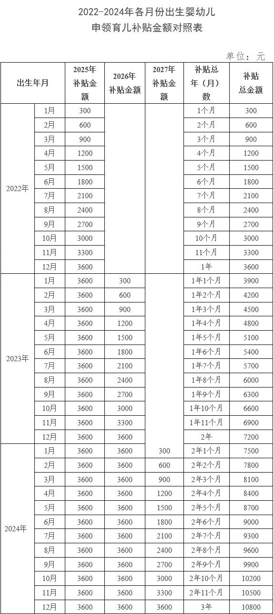

## 一、孕期优惠政策（上海口径）

> **地域与时效说明**：本节依据上海市医保局、市财政局、市卫健委联合印发的《关于进一步提升本市生育医疗费用保障有关政策的通知》（**2026 年 10 月 1 日起正式施行**）及官方《过渡衔接经办问答》整理。
>
> **重大制度革新（2026年10月新政）**：上海彻底告别过去「产检全自费垫付、生产后再申领 4500 元定额包干」模式，正式迈入合规生育医疗费用个人**「全流程零自付（无自付）」**时代——**门诊产检 42 项围产服务包直接刷医保卡实时结算（超 4500 元基金全额兜底免单，有结余可退现） + 住院分娩合规费用 100% 由生育保险基金支付（无痛分娩、剖腹产等零自付） + 居民医保产妇与未就业配偶全面扩面享受**。

### (一) 上海生育医疗费用保障新政架构（2026年10月1日起施行）

根据上海市医保局等部门印发的最新政策，本市生育保险医疗待遇形成全新保障架构：

| 待遇板块 | 核心机制与保障标准 | 就医与报销操作 |
| :--- | :--- | :--- |
| **门诊产前检查 （42 项围产服务包）** | 从建立大卡起至**产后 42 天康复复查**，42 项必备检查纳入基本医疗保健服务包。 • **额度冲抵**：优先使用每人 **4500 元** 的生育医疗费补贴额度。 • **超额全额兜底**：服务包总费用超过 4500 元的，**超出部分全部由生育保险基金承担，个人零自付**！ • **结余退还现金**：产后 42 天复查完成后，4500 元额度若有剩余，**结余资金可作为补贴申领退回给个人**。 | 挂号/缴费时**直接出示医保码或社保卡**实时扣减，无需个人垫资后再报销。 超出 42 项服务包外的普通诊疗按医保门诊结算；纯自费/特需项目自理。 |
| **住院分娩 （个人“无自付”）** | 在本市定点医疗机构产科分娩，出院产生的政策内住院医疗费用（**含分娩镇痛/打无痛、产程管理、顺产、剖宫产手术及耗材等**），**全部由生育保险基金支付，个人零自付**。 妊娠满 7 个月（28周）以上引产/流产，视同住院分娩享受同等报销待遇。 | 出院时通过医院医保窗口直接零自付结算。 （特需病房床位差价、伙食费、婴儿自费耗材等目录外费用个人承担）。 |
| **生育生活津贴 （产假工资）** | 产假期间的津贴收入：按女职工所在用人单位上年度职工月平均工资 ÷ 30 × **应享受天数**（顺产一般 158 天）计发。 | 产后通过「随申办」或社区事务受理服务中心申领，直接拨付至产妇个人银行卡。 |
| **受益人群扩面 （居民医保 & 配偶）** | • **城乡居民医保产妇**：统一享受服务包门诊产检与住院分娩个人“无自付”待遇。 • **未就业配偶享受**：男职工参加职工医保，其配偶参加上海居民医保的，产检服务包与住院分娩合规费用同样享受全额报销！ • **异地生育**：上海参保人在外省市定点医院发生的服务包费用及分娩住院费，一并纳入报销范围。 | 跨省异地就医按医保规定备案；居民医保及未就业配偶按医保经办通道清算。 |

#### 1. 门诊 42 项围产服务包涵盖范围
由过去的 25 项检验检查大幅扩容至 **42 项**，覆盖早中晚全孕期及产后基础保健需求：
- **门诊常规与监护**：产科门诊常规诊查、胎心监护、产后 42 天母婴复查诊查等；
- **排畸超声与影像**：早孕期 NT 超声筛查、中孕期胎儿系统解剖超声排畸（大排畸彩超）、晚孕期生长发育超声评估、心电图；
- **实验室检验**：血常规、尿常规、血型（ABO/Rh）、凝血功能、肝肾功能、血糖与糖耐量试验（OGTT）、甲状腺功能筛查、乙肝/丙肝/梅毒/HIV 传染病四项筛查、早孕唐氏综合征血清学筛查、晚孕期 B 族链球菌（GBS）筛查等。

#### 2. 生育周期跨越 2026 年 10 月 1 日的过渡清算衔接办法
对于在 2026 年 10 月 1 日前已开始自费产检、10 月 1 日后继续产检并分娩的准妈妈，上海市医保局制定了专门的过渡清算细则（《过渡衔接经办问答》）：
- **申领清算时点**：为了确保产后 42 天康复复查费用完整结算，**在宝宝出生满 50 天后**，可通过「随申办」或社区事务受理服务中心申请**“生育医疗费补贴剩余额度”清算**。
- **清算退现公式**：
  $$\text{剩余退现额度} = 4500\text{元} - (10\text{月}1\text{日后在本地医院刷卡结算的“服务包”费用}) - (10\text{月}1\text{日后在异地发生的“服务包”费用}) - (10\text{月}1\text{日前已通过医保基金支付的金额})$$
  - **若计算结果 $> 0$**：差额资金全额返还并打入个人银行卡；
  - **若计算结果 $\le 0$**：说明 10 月 1 日后的服务包已把 4500 元额度扣完，超出部分已由基金全额兜底免单，个人享受了免费医疗，无需再补缴，也无需申请清算。
- **特殊就医场景细则**：
  - **全程在特需部 / 国际部 / 非定点医院产检**：若孕期从未刷卡使用过 42 项服务包额度，分娩 50 天后申请清算，可**全额领取 4500 元**生育医疗费定额补贴。
  - **危重孕产妇**：新政下危重孕产妇的产检与住院分娩同样已实现个人无自付，申领清算时统一以 4500 元/人的补贴额度标准清算结余，结余部分可全额领取。
  - **灵活就业人员等待期**：设置 7 个月过渡期（2026年10月1日～2027年4月30日）。过渡期内即使在等待期内分娩，只要符合津贴申领条件，也可按上述办法清算领剩余补贴；2027年5月1日起与基本医保完全同步。
  - **10月1日前发生的自然流产/异位妊娠**：职保人员按原渠道申领定额补贴（满4个月800元、未满4个月600元）；10月1日后自然流产纳入普通医保门急诊结算，不再发放定额补贴。

#### 3. 申领与就医实操流程（上海）

| 场景 | 办理方式 / 就医操作 | 说明与入口 |
| :--- | :--- | :--- |
| **门诊产检** | 产检挂号与缴费时**出示医保电子凭证 / 社保卡** | 医院端自动识别生育服务包并冲抵 4500 额度，超额自动兜底免单。 |
| **住院分娩** | 入院登记时出示医保码或社保卡登记 | 出院时政策内分娩费用（含无痛打针、剖腹产）直接零自付结账。 |
| **津贴与结余申领** | 「随申办」APP / 小程序搜索 **「生育保险待遇申领（医保）」** 或街道社区事务受理中心 | 出生满 50 天后办理，津贴与剩余医疗费补贴一并结算至个人银行卡。 |
| **咨询答疑** | 上海市医保服务热线 **12393** / 随申办医保专区 | 一网通办事项进度可实时在「我的办件」查询。 |

---

### (二) 生育生活津贴与产假天数（上海）

#### 1. 说明

- 生育生活津贴俗称「产假工资」侧的基金支付部分。
- **高于**本人产假工资标准的，用人单位不得克扣；**低于**的，差额由用人单位**补足**。
- 上海侧常见表述：津贴**直接发放给个人**（增强获得感）；具体入账时间与单位是否先垫发，以经办结果与劳动合同/单位制度为准。
- 医保经办机构对符合条件的申领，常见承诺：**受理后 10 个工作日内办结**（以当年服务清单为准）。

#### 2. 计算公式（上海常用）

**生育生活津贴 ≈（女职工所在用人单位上一年职工月平均工资 ÷ 30）× 应享受的生育生活津贴天数**

注意：

- 计发基数是**单位上年度职工月平均工资**（有上下限封顶保底规则，变动工作单位还有加权等细则），**不一定等于个人工资条上的税前工资**。
- 应享受天数与**实际休假天数**可能不完全一致；人事与医保口径冲突时，以书面政策与经办答复为准。

#### 3. 上海常见「天数」怎么加

| 项目 | 天数（常见口径） | 依据方向 |
| --- | --- | --- |
| 国家规定产假 | **98 天**（其中产前可休 15 天） | 《女职工劳动保护特别规定》 |
| 难产 | 再加 **15 天** | 同上 |
| 多胞胎 | 每多生育 1 个婴儿再加 **15 天** | 同上 |
| 本市生育假（符合法律法规生育） | 女方再加 **60 天**（享受产假同等待遇） | 《上海市人口与计划生育条例》 |
| 配偶陪产假 | 男方 **10 天**（工资按正常出勤应得发给） | 同上 |
| 流产：未满 4 个月 | **15 天** | 国家规定 |
| 流产：满 4 个月 | **42 天** | 国家规定 |

**顺产生育、符合本市生育假条件时，女方产假/生育假合计常见为 98 + 60 = 158 天**（再叠加难产、多胞胎等）。

示例（仅帮助理解公式，非个人承诺）：

- 单位上年度职工月平均工资 9000 元，顺产且享受 158 天：  
  `9000 ÷ 30 × 158 = 47400` 元（津贴侧估算）。  
  若本人产假工资标准更高，差额由单位补足。

> 子女满三周岁前的**育儿假**见下文「二、(三)」，**不计入**生育生活津贴天数。

---

## 二、育儿优惠政策（上海 + 国家）

> **怎么读**：个税专扣与国家育儿补贴是**全国统一制度**；上海落地时多了户籍、随申办路径、材料清单等细节。假期看《上海市人口与计划生育条例》。各区托育补贴、企业福利**差异大**，本节只写可核的原则，不编造区级金额。

### (一) 3 岁以下婴幼儿照护专项附加扣除（个税）

**全国统一、上海同样适用**（填报入口一致）。

#### 1. 标准（已提高）

| 项目 | 标准 | 起算 |
| --- | --- | --- |
| 3 岁以下婴幼儿照护 | 每名婴幼儿 **每月 2000 元**（一年 24000） | 自 **2023 年 1 月 1 日**起（国发〔2023〕13 号） |
| 子女教育（顺带） | 每个子女 **每月 2000 元** | 同上；与「3 岁以下」按阶段衔接，勿重复填同一阶段 |

> 旧文「每月 1000 元」是 2022 年起标准，**2023 年起已提高为 2000**。上海税务局有专扣解读可核。

#### 2. 谁能扣、怎么分

- 纳税人照护 3 岁以下婴幼儿子女的相关支出，在计算个税前按上表**定额**扣除（不是按发票实报）。
- 扣除方式：可 **一方 100%**，或 **夫妻各 50%**。
- 监护人不是父母的（生父母、继父母、养父母以外的其他法定监护人等），符合规定的也可扣。
- 管理模式：**申报即可享受、资料留存备查**；一般**无需**把出生证原件交税务机关，但须留存备查。

#### 3. 怎么办（上海常见路径）

1. 打开 **个人所得税 APP** → 专项附加扣除 → 3 岁以下婴幼儿照护 → 填子女信息与夫妻分摊比例；或
2. 把信息交给**任职单位**代为填报，在发工资时按月享受；也可次年汇算一并享受。
3. 已按旧标准填过 2023 年及以后年度的，系统会按新标准计算；多缴税款可抵减后续月份或汇算退税（以税务系统实际规则为准）。

税务咨询：**12366**（上海税务）。解读示例：[提高专项附加扣除标准十问答（上海市税务局）](https://shanghai.chinatax.gov.cn/zcfw/zcjd/202309/t468509.html)。

---

### (二) 3 周岁以下婴幼儿育儿补贴（国家制度 · 上海申领）

#### 1. 制度要点（国家）

| 项 | 内容 |
| --- | --- |
| 实施起点 | **2025 年 1 月 1 日**起 |
| 对象 | 符合法律法规规定生育（及政策口径下的收养等）的 **3 周岁以下**婴幼儿；须有中国国籍 |
| 国家基础标准 | 每孩 **每年 3600 元**，至年满 3 周岁；按年发放 |
| 2025-01-01 及以后出生 | 可连续申领 **3 年**，合计 **10800 元** |
| 此前出生且未满 3 岁 | 按**应补贴月数**折算（详见国家对照表 / 下图） |
| 税收与救助 | 按规定发放的育儿补贴 **免征个税**；低保等认定时 **不计入**家庭或个人收入 |

权威问答可参考：[国家卫健委 · 育儿补贴制度政策问答](https://www.nhc.gov.cn/rkjcyjtfzs/c100147/202507/06cb12b180904128ae7e55620b713ac0.shtml)。

#### 2. 上海落地时多留意这几条

（综合本市街道/区级政策解读与国家方案；**以随申办当前页面与户籍地街镇为准**。）

1. **户籍**：本市解读常见表述为补贴对象须**已在上海市办理户籍登记**。外省市户籍孩子**不要默认**能在上海领同一套；按户籍地规则办。
2. **申领人**：以家庭为单位，确定 **1 名**申领人（父母一方、养父母，或监护人缺失时的其他监护人等）。离异一般由有抚养权一方申领。
3. **线上入口（上海）**  
   - 支付宝 / 微信「育儿补贴」小程序；或  
   - **随申办** APP / 微信或支付宝小程序 → 搜索 **「育儿补贴」** → 进入申领专区 /「育儿补贴信息管理系统」。
4. **线下**：婴幼儿**户籍所在地**乡镇政府（街道办事处）；特殊情形（机构申领、人脸识别失败等）可能必须线下。
5. **按年申请、逾期视为放弃当年**（本市街道问答常见口径）  
   - 2025-01-01 及以后出生：首次宜在出生当年或次年提出，并在之后连续两个年度续领。  
   - 2022 / 2023 / 2024 年出生：可申领次数与须提出的年度不同（例：2022 年出生常见仅 2025 年申 1 次等），**以系统提示为准**。
6. **材料方向**（首次申请较全，续领信息无变化可简化）  
   - 孩子：《出生医学证明》、《居民户口簿》首页及婴幼儿页；  
   - 申领人：身份信息、婚姻状况相关材料（结婚证；离异则离婚证及体现抚养权的材料等）；养父母需收养登记证明等。  
   - 境外出生医学证明：须附经认证的中文翻译件等。  
   - **勿只凭本文清单出门**，以当次系统/窗口清单为准。
7. **发放**：审核确认后发放至申领人或婴幼儿金融账户；区级可按季度集中发放一批等。多人争领、婚姻状态特殊等情形，可能强制打入**婴幼儿本人账户**。

区级解读示例（杨浦延吉新村街道，2025-09）：[育儿补贴常见问题](https://www.shyp.gov.cn/zhengwu/rdgz-rdgz/2025/296/274.html)——仅供对照，**不替代**全市统一系统规则。

#### 3. 和「地方加码」的关系

- 国家基础标准是 **3600 元/孩·年**。是否另有区级托育消费券、用人单位补贴等，**因区、因年、因项目而异**，本文**不写死金额**。
- 听闻某区「加发」时：先核对发文主体、适用户籍/居住、是否与国家补贴互斥，再申领。

---

### (三) 上海育儿假与相关假期（条例）

依据《上海市人口与计划生育条例》（2021 年修正）等，符合法律法规规定生育的夫妻：

| 假期 | 天数 / 规则 | 工资待遇（条例表述） |
| --- | --- | --- |
| 女方生育假 | 在国家产假外再加 **60 天**（见第一节） | 享受产假同等待遇 |
| 男方配偶陪产假 | **10 天** | 按本人正常出勤应得工资发给 |
| **育儿假** | 子女**年满三周岁前**，**双方每年各 5 天** | 按本人正常出勤应得工资发给 |

要点：

- 育儿假是**双方各自每年 5 天**，不是把 10 天全给一方（除非单位另有更优规定）。
- **不等于**生育生活津贴计发天数；一般走单位考勤/HR，不走医保生育津贴申领页。
- 条例鼓励单位采取灵活休假、弹性工作等，实际排休问 HR。
- 条例全文入口示例：[上海市发展改革委转载/公开页](https://fgw.sh.gov.cn/zlzt-rkzc/20230621/243a85a8a25a4872aa119ae0cbc7ae74.html)（以人大/市政府正式文本为准）。

---

### (四) 普惠托育与社区支持（原则，金额 ⏳）

条例明确市、区政府应建立健全**普惠托育服务体系**，托育机构按规定向区教育部门**备案**；社区改造配套婴幼儿活动场所；公共场所与女职工较多的单位配置**母婴设施**等。

对家庭实操建议：

1. 选托：查机构是否备案、收费是否纳入当地「普惠」目录、合同与退费规则。
2. 入口：随申办 / 区教育、卫健相关服务事项；社区卫生服务中心的儿童保健、预防接种与科学育儿指导可同步用。
3. 费用补贴、入托积分、用人单位托位：**各区政策更新快**，需要时再查当区最新通知，本文不写死数字。

---

### (五) 办完出生后的「政策清单」速查

| 事项 | 大致时机 | 入口 / 页面 |
| --- | --- | --- |
| 出生医学证明 | 分娩医院 | [待产证件资料](/00-待产证件资料) |
| 落户 | 按随父/随母等规则 | 同上 + 公安 |
| 生育保险待遇（津贴+医疗费补贴剩余清算） | 产检实时刷卡免单；住院分娩直接零自付；津贴与剩余补贴于出生满 50 天后申领 | 第一节；随申办「生育保险待遇申领（医保）」 |
| 育儿假 / 陪产假 | 产假结束后的育儿期 / 分娩前后 | 单位 HR + 条例 |
| 个税 3 岁以下照护扣除 | 有工资发放月或汇算 | 个人所得税 APP |
| 国家育儿补贴 | 按年度窗口 | 随申办 / 育儿补贴小程序 |
| 儿童保健、疫苗 | 按月龄 | 社区卫生服务中心 |

---

## 三、免责与维护

- 本文为信息整理，**不能替代**医保经办机构、税务机关、街镇窗口、用人单位人事的书面答复。
- 上海与国家文件、随申办表单会更新；发现金额/天数/户籍条件与官方不一致时，**以官方为准**，欢迎提 issue 或 PR 修正。
- 相关交叉阅读：[孕期总览](/P00-孕期总览)、[建档与产检时间表](/P02-建档与产检时间表)、[孕晚期与分娩准备](/P05-孕晚期与分娩准备)、[待产证件资料](/00-待产证件资料)。
